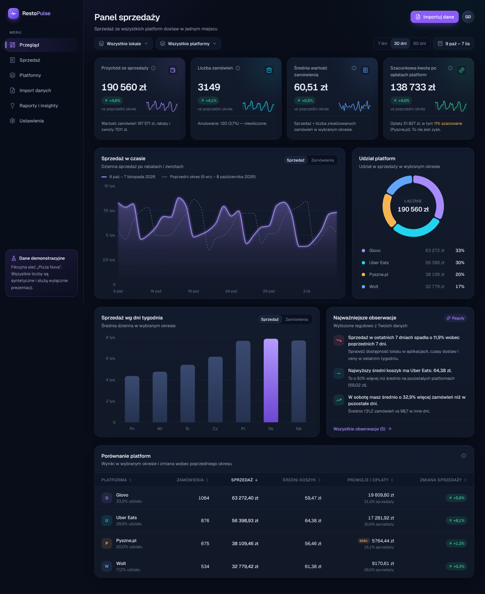

# RestoPulse

**Zrozum sprzedaż z platform dostaw w 2 minuty — bez ręcznego przekopywania Excela.**

Aplikacja SaaS dla właścicieli i managerów małych restauracji sprzedających przez Glovo, Uber Eats, Pyszne.pl i Wolt.
Właściciel wgrywa eksport CSV z panelu platformy, a RestoPulse normalizuje dane, liczy KPI i pokazuje, co się zmieniło.

> **Status: Etap 1 (MVP interfejsu).** Panel działa na w pełni syntetycznych danych demo (fikcyjna sieć „Pizza Nova”).
> Konta, baza danych i zapis importów to kolejne etapy — zob. [`docs/backlog.md`](docs/backlog.md).



## Co działa teraz

- **Landing** z propozycją wartości i wejściem do demo.
- **Przegląd** — 4 KPI ze sparkline i porównaniem okres do okresu, wykres sprzedaży w czasie (z poprzednim okresem), udział platform, sprzedaż wg dni tygodnia, regułowe obserwacje, sortowalna tabela platform.
- **Filtry** — lokal (2 lokale demo), platformy (wielokrotny wybór), zakres 7/30/90 dni lub własny.
- **Sprzedaż** — rozbicie wartość zamówień → rabaty → zwroty → sprzedaż; tabela dziennych sum i zamówień (filtr statusu, wyszukiwanie po ID, paginacja), **eksport CSV** z ochroną przed formula injection.
- **Platformy** — karty platform, wykres trendów, źródła danych (prowizje z pliku vs szacowane).
- **Import danych (podgląd)** — drag & drop CSV, wykrywanie separatora, polskie liczby i daty, automatyczne mapowanie kolumn z ręczną korektą, walidacja na sucho (błędy, duplikaty, waluta), wykrywanie raportów zbiorczych. Plik jest analizowany tylko w przeglądarce — nic nie jest zapisywane.
- **Raporty i insighty** — wszystkie obserwacje z podstawą obliczeń, lista pominiętych reguł z powodem, definicje KPI.
- **Ustawienia** — stawki prowizji per lokal i platforma z datą obowiązywania (w demo tylko w pamięci sesji); usunięcie stawki natychmiast zmienia KPI na „Brak danych”.

## Zasady liczenia

| Wskaźnik | Definicja |
|---|---|
| Sprzedaż | Σ (wartość − rabat − zwrot) zamówień zrealizowanych, z VAT. Anulowane pomijane. |
| Liczba zamówień | Zamówienia zrealizowane. |
| Średnia wartość zamówienia | Sprzedaż ÷ liczba zamówień. |
| Szacunkowa kwota po opłatach | Sprzedaż − prowizje i opłaty (z pliku albo szacowane wg stawek, oznaczone). **To nie jest zysk.** |
| Zmiana okres do okresu | Vs poprzedni okres tej samej długości — tylko gdy oba okresy mają pełne dane. |

Brak danych to „Brak danych”, nigdy 0 zł. Szczegóły: [`docs/architektura.md`](docs/architektura.md).

## Uruchomienie

Wymagania: Node.js 20+ (testowane na 22), npm.

```bash
npm install
npm run dev          # http://localhost:3000  →  „Zobacz demo”
```

Etap 1 nie wymaga żadnych kluczy ani zmiennych środowiskowych (`.env.example` opisuje zmienne kolejnych etapów).

### Polecenia

| Polecenie | Opis |
|---|---|
| `npm run dev` | serwer deweloperski |
| `npm run build && npm start` | build produkcyjny |
| `npm test` | testy jednostkowe (Vitest) — KPI, insighty, parser, mapowanie, eksport CSV |
| `npm run test:e2e` | testy Playwright (desktop + mobile) na buildzie produkcyjnym; najpierw `npm run build` i `npx playwright install chromium` (lub `PW_CHROME_PATH=/ścieżka/do/chrome`) |
| `npm run typecheck` / `npm run lint` | TypeScript / ESLint |
| `npm run samples` | generuje pliki testowe w `public/samples` |

## Dane testowe

`public/samples/` — wszystkie pliki z prefiksem `TESTOWE-`, w 100% syntetyczne, z wymyślonymi układami kolumn
(nie odwzorowują oficjalnych eksportów platform):

- `TESTOWE-zamowienia-format-A-glovo.csv` — polskie nagłówki, `;`, przecinek dziesiętny
- `TESTOWE-zamowienia-format-B-ubereats.csv` — angielskie nagłówki, `,`, czas UTC
- `TESTOWE-zamowienia-bez-prowizji-pyszne.csv` — brak prowizji → estymacja
- `TESTOWE-raport-dzienny-wolt.csv` — raport zbiorczy (wiersz = dzień)
- `TESTOWE-bledne-wiersze.csv` — błędy walidacji i duplikat

Instrukcja dla nieznanych formatów: [`docs/mapowanie-nieznanego-formatu.md`](docs/mapowanie-nieznanego-formatu.md).

## Struktura

```
src/app/              trasy (landing, /demo/*)
src/components/       layout, dashboard, ui, providers
src/lib/              logika domenowa bez Reacta (KPI, insighty, import, demo, CSV)
tests/unit, tests/e2e testy
docs/                 architektura, backlog, mapowanie, zrzuty ekranu
scripts/              generator plików testowych
```

## Bezpieczeństwo i prywatność

- Brak sekretów w repozytorium; `.env*` ignorowane (poza `.env.example`).
- Podgląd importu działa lokalnie w przeglądarce. Docelowo (Etap 2–3): izolacja danych przez `organization_id` + RLS w Supabase, limity plików i rate limit po stronie serwera.
- Eksport CSV neutralizuje formuły (`=`, `+`, `-`, `@`).
- Nagłówki bezpieczeństwa (`X-Frame-Options`, `nosniff`, `Referrer-Policy`, `Permissions-Policy`).
- Projekt nie deklaruje zgodności z RODO — przed komercyjnym startem potrzebna ocena prawna, polityka prywatności i regulamin.
- Nazwy platform służą wyłącznie identyfikacji formatów eksportu; brak integracji API i scrapingu.
